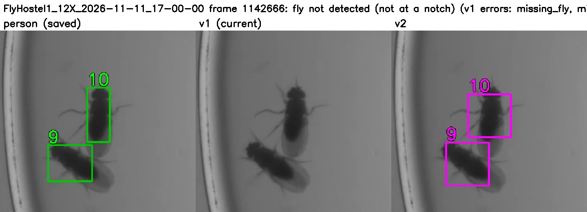
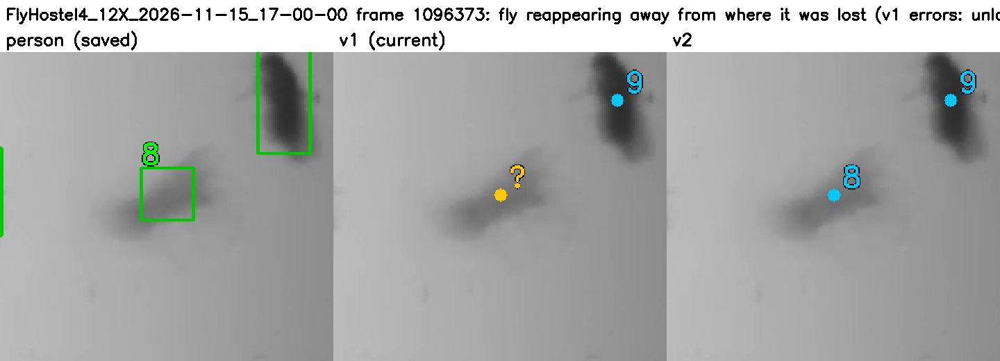
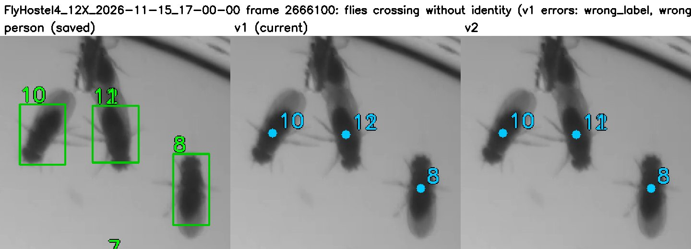

# Better automatic suggestions in the Annotate tab's scenes (2026-11-25)

Question: can the frames people already saved in validated multi-fly experiments (mostly 12X) make the proposals
in the scenes of *Prepare scenes* (scene_qc.csv) better?

Answer: yes, two changes, both prototyped behind opt-in switches (defaults unchanged):

1. **Tracker v2 of the continuity proposal** (`continuity.RunV2`, `?proposal=continuity2`, or the default with
   `ANNOTATE_CONTINUITY_VERSION=2`): on 12X, when the person steps through a scene, **40 % fewer edits**
   (frames entirely right 92.5 → 96.2 %); a scene proposed without any input inside it is entirely right in
   **76 % instead of 61 %** of the stretches.
2. **Learned scene scorer** (`scene_scorer.py`, `ANNOTATE_EASY_METHOD=learned`, model made by
   `scripts/train_scene_scorer.py`): on held-out 12X experiments it marks **68 % of the stretches easy at 99.2 %
   identity precision**, where the current rules mark 46 % at 96 % (92 % with whole frames, current proposal).

## Data

Sidecars (`flyhostel/validation/validator_annotations.db`) copied before reading (snapshots of 2026-11-25 ~19:00);
databases read with `mode=ro`, never written. Ground truth = each saved frame's boxes: a ROI_0 row inside a
labelled box (nearest the box centre, one to one) has that box's label; a labelled box without a row is a fly the
person drew where nothing was detected.

| experiment | flies | validated | saved frames (of them carried relabels) | scenes | stretches with every frame saved |
|---|---|---|---|---|---|
| FlyHostel4_12X_2026-11-15 | 12 | yes | 16656 (1863) | 5820 | 632 |
| FlyHostel3_12X_2026-11-10 | 12 | yes | 10351 (499) | 7261 | 824 |
| FlyHostel1_12X_2026-11-11 | 12 | yes | 3757 (430) | 1154 | 218 |
| FlyHostel4_12X_2026-11-20 | 12 | yes | 3189 (0) | 1315 | 272 |
| FlyHostel3_12X_2026-11-09 | 12 | yes | 1874 (87) | 1068 | 161 |
| FlyHostel1_3X_2026-08-28 | 3 | yes | 2895 | 245 | 237 |
| FlyHostel3_3X_2026-08-28 | 3 | yes | 1540 | 392 | 128 |
| FlyHostel2_4X_2026-11-10 | 4 | yes | 1553 | 650 | 176 |
| FlyHostel3_3X_2026-08-18 | 3 | yes | 879 | 585 | 59 |
| FlyHostel1_8X_2026-11-02 arena 4 | 2 | yes | 846 | 280 | 27 |
| FlyHostel1_6X_2026-11-08 | 6 | no | 1023 | 931 | 80 |

All saved frames are inside scenes; people saved scenes completely (only 9 stretches partly saved) but only
15–40 % of the stretches of each experiment (a ZT window). On 12X, 429,602 boxes were fly labels, 612 "ignored",
11 NEW-FRAGMENT tags, no FMB / CROSSING; no saved box carries a track.

## Protocols

- **Step**: every saved frame proposed as the server does when the person has saved the frames before it (anchor
  = the frame saved just before, else idtrackerai's stable frames in the person's labels). Errors = edits the
  person makes on that frame: `wrong_label`, `unlabelled` (identity errors on detected flies), `extra_label` (a
  detection the person left without fly), `missing_fly` / `ghost_misplaced` / `extra_ghost` (flies drawn where
  nothing was detected).
- **Cold**: each stretch whose frames were all saved, proposed from the anchor before it with no input inside it
  (what an auto-accepted scene would get). "Simulated edits": the person fixes each wrong frame and the proposal
  restarts from it.
- Learned scorer: leave one 12X experiment out (trained on the 9 other experiments, threshold chosen on their
  out-of-fold scores).

## Error taxonomy (12X, step protocol, per 100 frames)

| | missing fly | extra label | wrong label | unlabelled | extra ghost | frames entirely right |
|---|---|---|---|---|---|---|
| idtrackerai's boxes | 18.9 | 1.5 | 60.0 | 53.1 | – | 44.9 % |
| continuity (current) | **8.3** | 2.2 | 1.2 | 1.1 | 0.7 | 92.5 % |

- **Missing fly** is the main edit left: flies the person drew where nothing was detected (6763 on 12X). 34 % of
  them are **away from the notches**, where the current tracker keeps no box (all 1438 of FlyHostel1_12X_11-11,
  84 % of FlyHostel4_12X_11-20; FlyHostel4_12X_11-15 is the exception, 93 % at notches), mostly two touching
  flies that segmentation drops together, sitting still for hundreds of frames (e.g. FlyHostel1_6X: flies 1 and 2
  together for 131 frames; FlyHostel1_3X: one fly at the same spot in 473 frames). Near notches too, the current
  tracker misses some (it keeps the fly at the notch only when it was lost there).
- **Wrong label** (after a correct frame): 76 % are detections *without idtrackerai identity* 20–40 px from the
  right fly with another fly closer: crossings. When the fragment idtrackerai gave the detection continues the
  fragment the person labelled the frame before and disagrees with the nearest fly, the fragment is right 129 of
  138 times.
- **Unlabelled**: the fly moved 60–200 px since last seen (beyond the 60 px gate), mostly after not being
  detected for a few frames.
- **Extra label**: second detections of one fly / debris the person leaves unlabelled (not addressed).
- By scene reason, frames of "broken" scenes are the hardest (89 % right vs 96–100 % elsewhere).

## Results per idea

Step = frames entirely right / edits (12X, 35,827 frames); cold = stretches entirely right / simulated edits
(1696 stretches).

| tracker | 12X step | 12X edits | 12X cold | 12X cold edits | others step | others cold |
|---|---|---|---|---|---|---|
| current (`Run`) | 92.5 % | 4846 | 61.1 % | 4683 | 85.8 % | 62.2 % |
| + every undetected fly kept at its last position | 95.6 % | 3334 | 71.9 % | 3162 | 97.2 % | 78.7 % |
| + gate 40 px | 94.9 % | 3876 | 62.8 % | 3655 | 96.9 % | 77.0 % |
| + gate 80 px | 95.7 % | 3289 | 73.0 % | 3111 | 97.3 % | 79.7 % |
| + gate 100 px | 95.8 % | 3209 | 73.8 % | 3035 | 97.4 % | 80.2 % |
| + leftover pairing | 96.2 % | 2954 | 76.3 % | 2824 | 97.6 % | 81.6 % |
| + velocity prediction | 95.6 % | 3334 | 69.9 % | 3412 | 97.2 % | 77.9 % |
| + idtrackerai lid bonus 15 px | 95.5 % | 3483 | 71.9 % | 3319 | 97.2 % | 78.7 % |
| gate 100 + leftover | 96.2 % | 2986 | 76.2 % | 2848 | 97.6 % | 81.6 % |
| **gate 100 + leftover + fragment bonus 30 (`RunV2`)** | **96.2 %** | **2927** | **76.2 %** | **2799** | 97.6 % | 81.6 % |
| … + fragment bonus 60 | 96.2 % | 2938 | 76.2 % | 2814 | 97.6 % | 81.6 % |

(`RunV2` in the server reproduces the offline numbers exactly: `harness/repo_v2_eval.py`.)

Other ideas:

- **Bidirectional / keyframes** (person labels the first and last frame of a stretch, the middle tracked from
  both ends): both directions agree on 83.6 % of the middle frames, right 95.1 % of those; not good enough to fill
  scenes. A backward run from idtrackerai's stable frames after the stretch added nothing to the scorer.
- **Auto-accept** (cold, 12X; outcome with each method's own proposal):

  | rule | stretches accepted | frames | precision (identities) | precision (whole frames) |
  |---|---|---|---|---|
  | current rules (`classify_scenes`) | 778 (46 %) | 10002 | 96.0 % (v2) | 92.0 % (current proposal) |
  | forward = backward run agree | 730 (43 %) | – | – | 87.7 % |
  | learned, target identities, LOEO threshold | **1155 (68 %)** | 12371 | **99.3 %** | – |
  | learned, target whole frames, top 50 % | 848 (50 %) | 7730 | – | **98.2 %** |

  Whole-frame 99 % is not reached on held-out experiments: the remaining errors are flies drawn where nothing
  was detected (the person's box vs the kept one). Most useful features: closest pair of flies, largest blob vs
  median (merged flies), fly-frames kept undetected, detections without a fly of the anchor. Per held-out 12X
  experiment (training script, target identities): 96.6 % (FlyHostel1_12X_11-11, 118 accepted), 98.8 % (FH3_11-09,
  83), 100 % (FH3_11-10, 541), 98.6 % (FH4_11-15, 278), 100 % (FH4_11-20, 137).
- **Appearance re-ID** (crops / idtrackerai's identification network): not tried. idtrackerai's local identities,
  its appearance signal, are wrong in 60 % of the 12X scene frames and a bonus for them made things worse; the
  errors left by v2 are few (1.1 identity errors per 100 frames) and concentrated in crossings where a crop model
  would need training per experiment. Worth it only if the remaining crossing swaps turn out to cost much time.
- **Box geometry**: not measured (needs segmentation of every saved frame); the person rarely ignores boxes (612
  of 430k).

## Examples (person / current / v2)

Flies kept where they were last seen (two touching flies, not segmented, away from the notches):

A fly reappearing 60–200 px from where it was lost (current: no label):

Crossing without identity, fragment continuity (current swaps 11 and 12):

## Shipped in 1.7.0

Both are options in the Annotate tab, the defaults unchanged (continuity v1, rule-based easy scenes): the toolbar's
**Proposal** (Continuity v1 / v2) and **Easy** (Rules / Learned) choices, kept per browser; the pre-download holds the
frame data of the Proposal chosen. **Accept easy…** reviews the easy scenes (thumbnails, scores, a preview with the
boxes to be saved), saves the ticked ones in one go as the person (log: "accepted easy scene, continuity2, learned
0.97, batch N") and can undo a batch. Server-wide defaults: `ANNOTATE_CONTINUITY_VERSION`, `ANNOTATE_EASY_METHOD`.

## Recommendation and effort

1. Try `ANNOTATE_CONTINUITY_VERSION=2` on the next 12X experiment (one service restart, no client change); if
   it holds, make it the default (bump `CLASSIFY_VERSION` and switch `classify_scenes` to `RunV2` too). Client:
   a "Continuity v2" button and treating `source: continuity2` like `continuity` (`AnnotateTab.js` checks
   `source === 'continuity'` in 3 places) — ~½ day.
2. Learned easy scenes: `ANNOTATE_EASY_METHOD=learned` with the model in `~/.cache/idtrackerai-validator/
   scene_scorer/model.pkl` (trained 2026-11-25 on the 10 validated experiments, threshold 0.975). Retrain after
   each validated experiment (`scripts/train_scene_scorer.py`, ~5 min). To productionise: show the score in the
   scene list, an "accept all easy scenes" action that saves their proposals (today ◆ only marks them), and a
   per-experiment check after integration — ~1–2 days. Scoring a whole experiment takes ~3.5 min on one
   thread (FlyHostel4_12X_2026-11-20: 1315 scenes, 926 marked easy; one read per chunk plus the person's labels
   of the frames before each stretch).
3. Not worth it now: bidirectional fill, velocity prediction, idtrackerai lid bonus, appearance re-ID.

## Reproducing

`harness/` holds the offline evaluation (paths of the scratch folder it ran in; `extract.py` snapshots ROI_0 +
IDENTITY of the chunks with saved frames into npz, `step_eval.py` / `cold_eval.py` / `var_eval.py` replay the
proposals, `stretch_feats.py` + `train_scorer.py` the scorer, `variants.jsonl` the results above).
`scripts/train_scene_scorer.py` redoes the scorer from the experiments directly.
